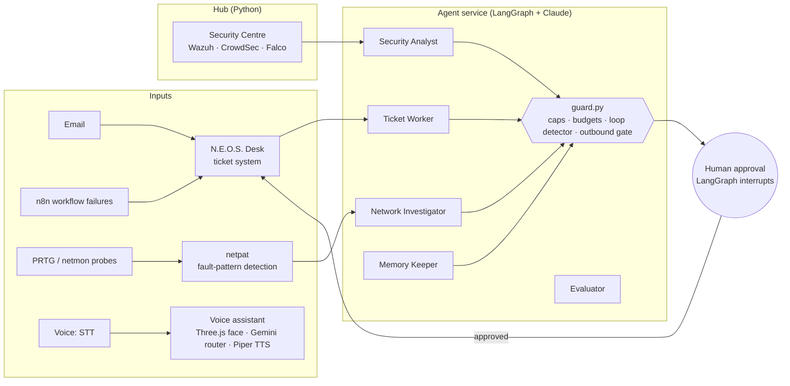

# N.E.O.S. — a self-hosted AI operations platform

N.E.O.S. is the platform I built and run 24/7 on my own Ubuntu server. It monitors, heals and secures my own infrastructure, runs a team of AI agents, and automates my day-to-day work.

This repository is a **showcase**. The full system holds credentials, personal data and client data, so it stays private. What's published here is the architecture, plus two complete, self-contained modules with their test suites.

## Architecture



| Layer | What runs there |
|---|---|
| **Agents** | Seven LangGraph agents with LangSmith tracing, SQLite checkpoints and human-approval interrupts. Scheduled Claude agents act as system manager and engineering staff, and every change they propose is held for my sign-off. An Opus + Haiku per-agent model split keeps costs down. |
| **Voice assistant** | A 3D animated face (Three.js PWA), a Gemini router, speech-to-text and local text-to-speech. Reply latency went from about 20 s to under 3 s. |
| **Operations** | One ticket desk for email, n8n failures and phone push alerts. A fleet dashboard over Tailscale with a file manager and remote desktop. A self-healing service guardian. |
| **Network** | Outage and packet-loss pattern detection that runs its own traceroute investigation and writes a fault report ready to send to the ISP. |
| **Security** | Wazuh SIEM, CrowdSec and Falco, plus an automated analyst, pen-tester and engineer team that checks findings against OSV and CISA KEV. Authelia SSO, nightly Kopia backups. |
| **Infra** | Ubuntu Server 24.04, Docker Compose, systemd units with memory limits, Caddy, self-hosted n8n and PostgreSQL. |

## Published modules

Both modules use only the Python standard library, so they run anywhere.

### [`src/guard.py`](src/guard.py): guardrails for autonomous agents

Every agent run passes through these brakes, enforced in code rather than in the prompt:

- **Token cap per run.** A run that reads or argues past its cap is stopped.
- **Daily token budget,** per agent and for the whole service.
- **Run-rate limit per hour,** so a scheduler or self-retry loop can't spin.
- **Loop detector.** The same step producing the same line again and again is treated as a stuck loop, not work.
- **Outbound gate.** Every write an agent makes is capped per hour, and identical writes inside a quiet window are dropped, so the agents can't spam anyone.

A block always fails safe. The run stops with a clear reason, one alert names the brake that held, and nothing half-done is sent. `GuardBlocked` subclasses `RuntimeError` on purpose, so LangGraph's retry policy won't retry it.

### [`src/netpat.py`](src/netpat.py): network fault patterns, and the investigation they trigger

A dashboard can answer "is it up right now?". An ISP needs "it drops three times a night, always between 19:00 and 21:30, and the loss starts at your second hop" before it will act. This module bridges that gap.

- **Analysis** (pure functions over the monitoring history) finds flap storms, loss that recurs at the same hour on several days, latency drift and loss trends.
- **Investigation** runs *inside* the bad time window: a traceroute, a simultaneous ping burst at every hop, a gateway-versus-WAN comparison and a throughput check. It ends in a verdict that names a hop, plus a paragraph you can paste into a ticket.
- It refuses to blame a hop for its own ICMP rate limiting, which is one of the classic ways to be confidently wrong at an ISP.

## Run the tests

```bash
python tests/test_guard.py
python -m unittest tests/test_netpat.py
```

That's 31 guard checks and 50 netpat tests.

## Stack

Python · LangGraph · LangSmith · Claude · Google Gemini · Ollama · n8n · PostgreSQL · SQLite · FastAPI · Docker Compose · systemd · Caddy · Tailscale · Authelia · Wazuh · CrowdSec · Falco · Three.js · Piper TTS · Netdata · Uptime Kuma · Kopia
